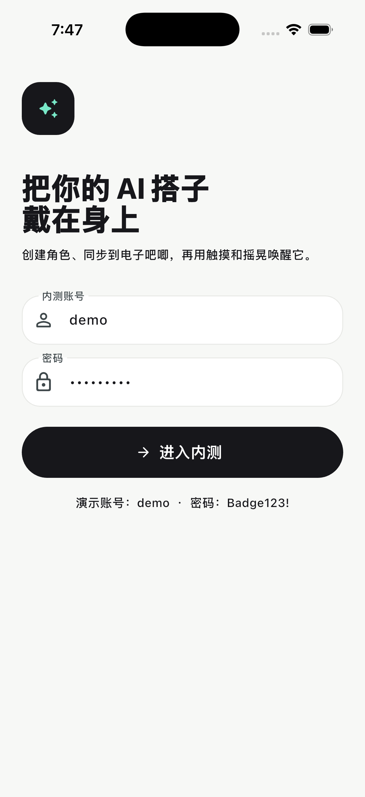

# AI 吧唧（AI Badge）

[](LICENSE)

AI 吧唧是一个“AI 角色创作 + 随身 BLE 显示终端”的开源原型。仓库提供
Flutter 客户端、NestJS 演示 API、BullMQ Worker、Docker 本地基础设施和虚拟设备，
用于验证下面这条产品链路：

`演示登录 → 创建角色 → 虚拟设备配对 → 资源同步 → 动作测试 → AI 对话`

> 当前 `0.1.x` 是单账号、内存存储的开发演示，不是生产服务。真实 BLE、OTA、
> 多用户隔离和业务持久化尚未完成，请勿直接暴露到公网或保存真实用户数据。



## UI 设计稿

产品界面的原始设计与页面说明维护在
[即时设计 · ai吧唧appUI](https://js.design/f/oc2U7h?mode=design&p=7au89U9b0W)。
设计文件目前包含新手引导、首页、角色创建、聊天、手机控制电子吧唧、设备绑定、
“我的”和注册登录等核心页面。

[](https://js.design/f/oc2U7h?mode=design&p=7au89U9b0W)

上图是设计稿总览快照，点击图片可打开可缩放的原始设计文件。Flutter 实现应优先
遵循原始设计稿，再参考 [UI 规格](docs/UI_SPEC.md) 中的颜色、组件和状态约束。

## 当前实现状态

已经可以演示：

- Flutter 设计系统、核心流程页面和离线 Mock 模式；
- `DevicePort`、内嵌虚拟设备、设备状态机和故障注入工具；
- NestJS JWT/Argon2 演示登录、标准错误、SSE、角色、设备和对话接口；
- BullMQ Worker，以及可替换的图片生成、对话和内容审核接口；
- Prisma 数据模型、OpenAPI 契约及 PostgreSQL、Valkey、MinIO 的本地容器脚手架；
- Node 与 Flutter 自动化测试和 GitHub Actions CI。

尚未完成：

- API 业务数据仍保存在进程内存中，重启后会丢失；
- Prisma、PostgreSQL 和 MinIO 尚未接入 API 业务读写；
- 真实 AI 需要自行配置兼容的生成、对话和审核模型；
- 真实 BLE UUID、鉴权、传输帧、资源格式和 OTA 需等待硬件协议冻结；
- 公开注册、多账号生产隔离、好友、付费和开放社交不在当前版本范围。

## 工程结构

```text
apps/mobile             Flutter iOS/Android 客户端
apps/api                NestJS 演示 API
apps/worker             AI、审核和资产任务 Worker
packages/openapi        OpenAPI 3.1 契约
tools/virtual-device    独立虚拟设备与故障注入
infra                   Docker Compose（PostgreSQL、Valkey、MinIO）
docs                    UI、BLE、运行和安全说明
doc                     产品与开发设计文档
```

## 最快查看界面

Flutter 默认使用离线 Mock，不需要启动 API 或 Docker：

```bash
cd apps/mobile
flutter pub get
flutter run
```

iOS 开发需要完整 Xcode 和 iOS Simulator Runtime；Android 开发需要 Android Studio、
Android SDK，并正确设置 `ANDROID_HOME`。仓库已经包含两端原生工程。

离线演示账号是 `demo`，密码是 `Badge123!`。这组凭据只控制客户端 Mock，不应作为
任何公网后端账号使用。iPhone 模拟器的详细操作见
[iOS 启动指南](docs/IOS_SIMULATOR_RUNBOOK.md)。

## 启动演示 API

要求 Node.js 24 和 pnpm 11.16：

```bash
pnpm install --frozen-lockfile
cp apps/api/.env.example apps/api/.env
```

编辑 `apps/api/.env`，至少替换 `JWT_SECRET` 和 `DEMO_PASSWORD`，然后运行：

```bash
pnpm --filter @ai-badge/api start:dev
```

默认地址：

- API：`http://127.0.0.1:3000/v1`
- 健康检查：`http://127.0.0.1:3000/v1/health`
- Swagger：设置 `ENABLE_SWAGGER=true` 后访问 `http://127.0.0.1:3000/v1/docs`

连接 API 时，把你在 `.env` 中设置的演示账号输入 App，并运行：

```bash
cd apps/mobile
flutter run --dart-define=API_BASE_URL=http://127.0.0.1:3000/v1
```

Android 模拟器访问宿主机时使用 `http://10.0.2.2:3000/v1`。

## 使用 Docker

```bash
cp infra/.env.example infra/.env
```

先在 `infra/.env` 中生成并填写随机密码，再启动：

```bash
docker compose --env-file infra/.env -f infra/docker-compose.yml up --build -d
```

服务只绑定本机回环地址。完整的启动、关闭、日志和数据说明见
[Docker 指南](docs/DOCKER_RUNBOOK.md)。Docker 只搭起依赖服务，不代表 API 已使用
PostgreSQL 或 MinIO 持久化业务数据。

## 虚拟设备服务

App 默认使用内嵌 `VirtualDeviceAdapter`。独立故障注入服务可以这样启动：

```bash
pnpm --filter @ai-badge/virtual-device dev
curl -X POST http://127.0.0.1:4100/pair
curl -X POST http://127.0.0.1:4100/fault/disconnect
curl -X POST http://127.0.0.1:4100/sync
```

## 验证

```bash
pnpm build
pnpm lint
pnpm test
pnpm test:e2e
pnpm audit:prod

cd apps/mobile
dart format --output=none --set-exit-if-changed lib test
flutter analyze
flutter test
```

当前 iOS 流程在 Flutter 3.44.9、Xcode 26.6 和 iOS 26.5 Simulator 上验证过；
其他兼容稳定版本由 CI 和贡献者持续验证。

## 安全、隐私与贡献

- 生产部署警告和漏洞报告方式见 [SECURITY.md](SECURITY.md)。
- 资产和参考图规则见 [docs/ASSET_POLICY.md](docs/ASSET_POLICY.md)。
- 贡献流程见 [CONTRIBUTING.md](CONTRIBUTING.md)。
- 真实 AI Provider 会接收提示词、对话或生成资产。启用前必须选择合规提供商，
  配置真实审核，并向用户说明数据去向与保留策略。

## License

本项目按 [Apache License 2.0](LICENSE) 开源。第三方依赖说明见
[THIRD_PARTY_NOTICES.md](THIRD_PARTY_NOTICES.md)。
