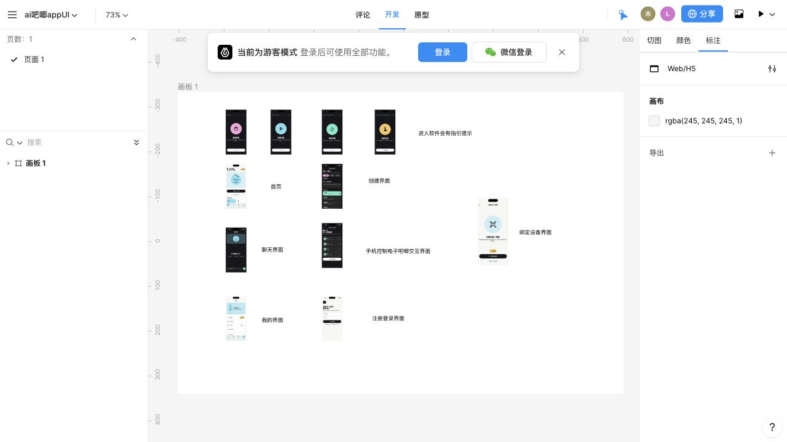

# AI 吧唧 UI 规格 v0.1

## 原始设计与页面总览

界面视觉和页面布局的主要来源是
[即时设计 · ai吧唧appUI](https://js.design/f/oc2U7h?mode=design&p=7au89U9b0W)。
该链接是可缩放、可查看标注的原始设计文件；本文档负责记录可以直接映射到 Flutter
代码的设计令牌、组件状态和验收要求。两者冲突时，先确认原始设计的最新版本，再同步
修改本文档和代码。

当前设计总览覆盖：

1. 进入软件后的四步引导提示。
2. 首页与角色状态总览。
3. 角色创建界面。
4. AI 聊天界面。
5. 手机控制电子吧唧的动作交互界面。
6. 设备绑定界面。
7. “我的”页面。
8. 注册和登录界面。

仓库内图片是方便 GitHub 阅读的快照，不代替原始设计文件。设计稿更新后，应同步更新
`docs/assets/ui-design-overview.jpg`、页面实现和相关 Golden 测试。

## 视觉原则

- 借鉴参考图的黑白大色块、胶囊选择、超大圆角和角色中心构图，不复制其品牌或页面。
- 首页、设备和设置使用 `#F7F8F6`；创作、动作和对话使用 `#191919`。
- 连接/平静使用 `#78E7C7`，同步/AI 使用 `#89DDF0`，人格/情绪使用 `#F5A6D9`。
- 每页仅一个主按钮。需要处理的错误使用可操作面板，不用短暂 Toast 代替。

## 组件与页面映射

| 组件 | 页面 | 必测状态 |
|---|---|---|
| `CharacterStage` | 首页、生成、同步、对话、我的 | 无角色、静态、呼吸、减少动态 |
| `DeviceStatusPill` | 首页、绑定、同步、我的 | 未绑定、搜索、配对、在线、离线、同步、升级 |
| `EmotionChip` | 首页、创作、人格 | 未选、选中、禁用、动态字体 |
| `ProgressRail` | 生成、同步、OTA | 0%、进行中、99%、完成、失败 |
| `ActionMappingCard` | 动作配置 | 在线测试、离线、超时、收到回执 |

## 无障碍门槛

- 触控目标不小于 44×44pt；正文不低于 13sp。
- 文字和关键图标达到 WCAG AA 对比度。
- 角色动画尊重系统“减少动态效果”。
- 状态不只依靠颜色，必须同时使用文字和图标。
- 动态字体增大时，按钮、胶囊和卡片允许换行，不裁切文本。
